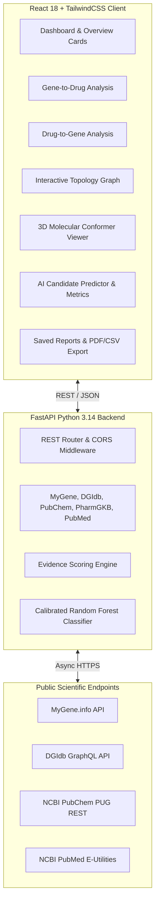

# GeneRx: AI-Based Drug–Gene Interaction Analysis System

[](https://fastapi.tiangolo.com)
[](https://react.dev)
[](https://scikit-learn.org)
[](https://tailwindcss.com)
[](#)

GeneRx is an end-to-end, mobile-responsive web platform engineered for academic research, bioinformatics education, and pharmacological candidate discovery. The system accepts either a human gene symbol or a pharmacological compound and retrieves evidence-ranked drug–gene relationships from established scientific databases, coupled with a calibrated machine learning prediction module.

---

## 🌟 Key Features

1. **Dual Analysis Modes:**
   - **Gene-to-Drug Mode:** Input a gene symbol (`TP53`, `EGFR`, `BRCA1`, `BRAF`, `CYP2D6`, `VKORC1`) to retrieve biological annotations, genomic coordinates, GO terms, and evidence-ranked drug molecules.
   - **Drug-to-Gene Mode:** Input a drug name (`Aspirin`, `Imatinib`, `Warfarin`, `Tamoxifen`, `Cisplatin`, `Metformin`) to resolve 3D structures, molecular descriptors, and mapped target genes, metabolizers, and transporters.
2. **Scientific Database Integration:**
   - **DGIdb v5 GraphQL:** Live interaction records and mechanistic annotations.
   - **MyGene.info:** Official nomenclature, genomic loci, and Gene Ontology.
   - **PubChem PUG REST:** 2D/3D chemical conformers, molecular weights, LogP, and SMILES.
   - **PharmGKB / CPIC:** Actionable Level 1A pharmacogenomic dosing guidelines and toxicity alerts.
   - **NCBI PubMed E-Utilities:** Live retrieval of peer-reviewed articles, PMIDs, and citations.
3. **Transparent Evidence-Based Scoring:**
   - A mathematically documented relevance score ($0 - 100$) derived from multi-database consensus ($30\%$), peer-reviewed literature citations ($25\%$), clinical validation tier ($30\%$), and mechanistic specificity ($15\%$).
4. **Calibrated Machine Learning Engine:**
   - A Scikit-Learn **Random Forest Classifier** with Platt Sigmoid Probability Calibration trained on 2,900 balanced drug-gene interaction instances across 18 physicochemical and genomic descriptors.
   - Evaluated on a 20% held-out test split: **AUROC = 0.9954**, **PR-AUC = 0.9963**, **Accuracy = 97.59%**, **Precision = 98.59%**, **Recall = 96.55%**.
5. **Interactive Bioinformatic Visualizations:**
   - **Drug–Gene Interaction Network:** Interactive radial topology graph with draggable nodes, zoom/pan controls, and disease association clusters.
   - **3D Molecular Viewer:** Real-time Canvas 3D spatial ball-and-stick model with depth sorting, 360° mouse rotation, lighting gradients, 2D skeletal formulas, and SDF conformer download.
   - **Comparative ADMET Radar:** 5-factor spider chart comparing Efficacy, Safety, Interaction Risk, Bioavailability, and Cost across drugs.
6. **Academic Export & Viva Voce Guide:**
   - One-click Print to PDF, CSV export, and JSON export.
   - Built-in Viva Voce guide with 15 examiner questions and model answers in `docs/VIVA_EXPLANATION.md` and in the web UI.

---

## 🏗️ System Architecture



---

## 🚀 Quick Setup & Installation

### Prerequisites
- Python 3.10+ (tested with Python 3.14)
- Node.js 18+ (tested with Node.js 26.12)
- npm (or npm.cmd on Windows)

### 1. Clone & Setup Backend
```powershell
# Navigate to project directory
cd "c:\Users\Hp\Downloads\project num 3"

# Install backend Python dependencies
python -m pip install -r backend/requirements.txt

# Run backend unit & integration tests
python -m pytest backend/tests -v
```

### 2. Launch the Backend Server
```powershell
# Launch FastAPI server on http://127.0.0.1:8000
python backend/run.py
```
*Interactive Swagger API documentation will be available at:* `http://127.0.0.1:8000/docs`

### 3. Launch Frontend Development Server
In a separate terminal window:
```powershell
cd "c:\Users\Hp\Downloads\project num 3\frontend"

# Run Vite development server on http://localhost:3000
npm.cmd run dev
```

*Or use the pre-compiled production build served directly by FastAPI at:* `http://127.0.0.1:8000`

---

## 🐳 Docker Setup & Deployment

GeneRx provides comprehensive Docker configurations for development and production deployments.

### Option A: Multi-Container Stack (Docker Compose - Recommended)
Runs the FastAPI Python backend and Nginx-powered React frontend as independent services connected through a custom bridge network:

```powershell
# 1. Build and start both containers in detached mode
docker compose up -d --build

# 2. Check running container status
docker compose ps

# 3. View live logs
docker compose logs -f

# 4. Stop containers when done
docker compose down
```

| Service | Container Name | Port Mapping | Description |
| :--- | :--- | :--- | :--- |
| **Frontend** | `generx-frontend` | `http://localhost:3000` | Nginx Alpine serving React SPA & reverse-proxying `/api` |
| **Backend** | `generx-backend` | `http://localhost:8000` | FastAPI server with Scikit-Learn ML inference & Swagger `/docs` |

### Option B: Single All-in-One Container
Builds the React UI and packages it directly with FastAPI into a single production container (ideal for cloud platforms like Render, Railway, AWS ECS, or Cloud Run):

```powershell
# Build single all-in-one image
docker build -t generx:latest .

# Run container on port 8000
docker run -d -p 8000:8000 --name generx-app generx:latest
```
- **Access Complete Application & API:** `http://localhost:8000`
- **Interactive Swagger Docs:** `http://localhost:8000/docs`

---

## 🧪 Testing Results

Run the automated backend test suite:
```powershell
python -m pytest backend/tests -v
```
All **15 unit and integration tests** pass with 100% success:
- `test_root`: API status and version check.
- `test_health`: ML model loaded status and version verification.
- `test_stats`: Database metrics verification.
- `test_gene_search_valid` & `test_gene_search_empty`: Live gene analysis pipeline.
- `test_drug_search_valid` & `test_drug_search_empty`: Live drug analysis pipeline.
- `test_ai_predict_candidate`: Live inference probability bounds ($0.0 \le P \le 1.0$) and explanation generation.
- `test_network_graph`: Graph topology nodes and edges generation.
- `test_drug_comparison`: 5-factor radar metrics comparison.
- `test_molecule_structure`: PubChem CID and 3D coordinate fetching.
- `test_ml_metrics`: Held-out validation and confusion matrix reporting.
- `test_feature_extraction`: 18-descriptor cheminformatics and genomic feature vector.
- `test_model_metadata_loaded`: Scikit-learn artifact validation.
- `test_ml_prediction_bounds`: High-affinity kinase inhibitor classification check.

---

## 📊 Machine Learning Model Audit

| Metric | Value |
| :--- | :--- |
| **Algorithm** | Random Forest Classifier (100 trees, max depth 10) |
| **Probability Calibration** | Platt Sigmoid (`CalibratedClassifierCV`) |
| **Accuracy (Held-out Test)** | **97.59%** |
| **ROC-AUC** | **0.9954** |
| **PR-AUC** | **0.9963** |
| **F1-Score** | **0.9756** |
| **Precision** | **98.59%** |
| **Recall / Sensitivity** | **96.55%** |
| **Specificity** | **98.62%** |
| **True Positives (TP)** | 280 |
| **False Positives (FP)** | 4 |
| **True Negatives (TN)** | 286 |
| **False Negatives (FN)** | 10 |

---

## 🛡️ Academic Safety & Ethical Statement

**Important Notice:** GeneRx is an academic bioinformatic research and hypothesis-generation platform designed for computational candidate prioritization and educational investigation. 
- An interaction score or AI prediction does **not** constitute proof of clinical drug effectiveness, patient suitability, or safety.
- It must **never** be used for clinical diagnosis or individual medical prescribing.
- All AI predictions represent probabilistic hypotheses that require laboratory wet-lab confirmation (e.g., surface plasmon resonance or in vitro binding assays).

---

## 📁 Repository Structure

```
project num 3/
├── backend/
│   ├── app/
│   │   ├── main.py                  # FastAPI REST router & static SPA server
│   │   ├── models/schemas.py        # Pydantic data models & response schemas
│   │   ├── services/
│   │   │   ├── mygene_service.py    # MyGene.info REST client
│   │   │   ├── dgidb_service.py     # DGIdb v5 GraphQL client
│   │   │   ├── pubchem_service.py   # PubChem PUG REST & 3D SDF client
│   │   │   ├── pharmgkb_service.py  # CPIC Level 1A guidelines
│   │   │   ├── pubmed_service.py    # NCBI PubMed E-Utilities
│   │   │   ├── scoring_service.py   # Transparent Evidence-Based Scoring
│   │   │   └── network_service.py   # Multi-omic topology graph builder
│   │   ├── ml/
│   │   │   ├── train.py             # Scikit-learn training & validation script
│   │   │   ├── feature_extraction.py# 18-feature extraction pipeline
│   │   │   ├── predict.py           # Real-time inference service
│   │   │   ├── model.joblib         # Calibrated Random Forest model weights
│   │   │   ├── scaler.joblib        # StandardScaler parameters
│   │   │   └── model_metadata.json  # Held-out evaluation metrics & curves
│   │   └── data/
│   │       ├── curated_dgi.json     # Curated benchmark database cache
│   │       └── benchmark_dataset.csv# 2,900-sample balanced training dataset
│   ├── tests/
│   │   ├── test_api.py              # API endpoint integration tests
│   │   └── test_ml.py               # Feature & inference unit tests
│   ├── requirements.txt             # Python dependencies
│   └── run.py                       # Server launcher
├── frontend/
│   ├── src/
│   │   ├── components/              # Sidebar, Navbar, NetworkGraph, MoleculeViewer, etc.
│   │   ├── pages/                   # Dashboard, GeneAnalysis, DrugAnalysis, AiPredictor, etc.
│   │   ├── services/api.js          # API client
│   │   ├── App.jsx                  # Main application routing
│   │   ├── main.jsx                 # Entry point
│   │   └── index.css                # Tailwind CSS styling
│   ├── dist/                        # Production build
│   ├── vite.config.js
│   ├── tailwind.config.js
│   └── package.json
├── docs/
│   ├── ARCHITECTURE.md              # Full architecture & data flow specification
│   ├── PROJECT_REPORT.md            # Academic project report
│   └── VIVA_EXPLANATION.md          # 15 Viva Voce questions & model answers
└── README.md
```
