# AI-Based Drug–Gene Interaction Analysis System (GeneRx)
## Architecture & Data Flow Specification

### 1. Architectural Overview

The **GeneRx** platform is designed as a decoupled, multi-tier bioinformatics and academic discovery suite adhering to modern biomedical informatics standards:

```mermaid
flowchart TD
    subgraph Frontend["Frontend Client (React + Vite + TailwindCSS)"]
        UI_Dash["Dashboard & Global Search"]
        UI_Gene["Gene-to-Drug Analysis Mode"]
        UI_Drug["Drug-to-Gene Analysis Mode"]
        UI_Net["Interactive Network Graph (Cytoscape / 2D Canvas)"]
        UI_Mol["3D/2D Molecular Viewer (3Dmol.js / PubChem)"]
        UI_AI["AI Candidate Predictor & Metrics"]
        UI_Export["Report Generation (PDF / CSV / JSON)"]
    end

    subgraph Backend["Backend Application (FastAPI + Python 3.14)"]
        API_GW["FastAPI REST Router & CORS Middleware"]
        
        subgraph Services["Biomedical Data Retrieval & Integration Layer"]
            S_MyGene["MyGene.info Client (Gene Annotation, Genomic Loci, GO)"]
            S_DGIdb["DGIdb Client (Drug-Gene Interaction Records)"]
            S_PubChem["PubChem REST Client (3D SDF, SMILES, MW, LogP, ADMET)"]
            S_PharmGKB["PharmGKB / ClinPGx Client (Clinical Pharmacogenomics & CPIC)"]
            S_PubMed["NCBI PubMed E-Utilities Client (Live Literature & PMIDs)"]
            S_Cache["In-Memory & Curated Benchmark Cache"]
        end

        subgraph CoreLogic["Scientific Scoring & Graph Aggregation"]
            ScoreEngine["Evidence-Based Scoring Engine (Weighted Multi-Factor)"]
            NetBuilder["Network Topology Builder (Nodes, Edges, Clusters)"]
            ADMETComp["Drug Comparative Radar Profiler"]
        end

        subgraph AI_Engine["Machine Learning Prediction Engine (Scikit-Learn)"]
            FeatEng["Cheminformatics & Genomic Feature Extractor"]
            ML_Model["Random Forest Classifier (Calibrated Probability)"]
            ML_Eval["Held-Out Validation & Metrics (AUROC, AUPR, F1, Confusion Matrix)"]
            SHAP_Exp["Feature Importance & Attribution Explainer"]
        end
    end

    subgraph ExternalAPIs["External Biomedical Databases"]
        Ext_MyGene["MyGene.info API"]
        Ext_DGIdb["DGIdb API / Curated Benchmark"]
        Ext_PubChem["NCBI PubChem PUG REST"]
        Ext_PharmGKB["PharmGKB / ClinPGx API"]
        Ext_NCBI["NCBI PubMed E-Utilities"]
    end

    %% Connections
    UI_Dash --> API_GW
    UI_Gene --> API_GW
    UI_Drug --> API_GW
    UI_Net --> API_GW
    UI_Mol --> API_GW
    UI_AI --> API_GW
    UI_Export --> API_GW

    API_GW --> S_MyGene & S_DGIdb & S_PubChem & S_PharmGKB & S_PubMed
    S_MyGene --> Ext_MyGene
    S_DGIdb --> Ext_DGIdb
    S_PubChem --> Ext_PubChem
    S_PharmGKB --> Ext_PharmGKB
    S_PubMed --> Ext_NCBI

    S_MyGene & S_DGIdb & S_PubChem & S_PharmGKB & S_PubMed --> ScoreEngine & NetBuilder & ADMETComp
    ScoreEngine & NetBuilder --> API_GW

    API_GW --> FeatEng
    FeatEng --> ML_Model
    ML_Model --> SHAP_Exp
    ML_Eval --> API_GW
    SHAP_Exp --> API_GW
```

---

### 2. Detailed Data Flow

#### Flow A: Gene-to-Drug Analysis Mode
1. **User Input:** User submits a standard human gene symbol (e.g., `TP53`, `EGFR`, `BRCA1`, `BRAF`, `CYP2D6`).
2. **Annotation Resolution:** Backend calls `MyGene.info` to retrieve official nomenclature, aliases, Entrez Gene ID, Ensembl ID, chromosome coordinates, Gene Ontology (GO terms), and pathway memberships.
3. **Known Interaction Fetching:** DGIdb and curated scientific databases are queried for drug molecules interacting with the gene target.
4. **Pharmacogenomic Enrichment:** PharmGKB / ClinPGx is queried to detect clinical dosing guidelines (e.g., CPIC Level 1A/1B), metabolizer phenotypes, or adverse effect markers.
5. **Literature Corroboration:** NCBI PubMed E-Utilities extracts verified PMIDs, publication years, and article titles.
6. **Evidence Scoring:** The Evidence Scoring Engine calculates a normalized relevance score ($S_{evidence} \in [0, 100]$) based on source database diversity, peer-reviewed citation volume, clinical guideline level, and interaction mechanism specificity.
7. **AI Prediction Overlay:** For each drug-gene pair, the ML feature pipeline extracts physicochemical and genomic descriptors to output a separate computational probability ($P_{AI} \in [0.0, 1.0]$) alongside the known evidence score.
8. **Client Rendering:** Results are presented in an interactive table with filtering, sorting, expandable evidence modals, and an interactive network visualization.

#### Flow B: Drug-to-Gene Analysis Mode
1. **User Input:** User enters a pharmacological compound name (e.g., `Aspirin`, `Imatinib`, `Warfarin`, `Cisplatin`, `Tamoxifen`).
2. **Chemical Identification:** PubChem PUG REST resolves the chemical structure: PubChem CID, canonical SMILES, 2D/3D SDF coordinates, molecular formula, molecular weight, LogP, and H-bond donors/acceptors.
3. **Target & Metabolism Retrieval:** DGIdb and curated databases return target genes, metabolic enzymes (CYP450), transporters (ABC/SLC), and downstream signaling effectors.
4. **Clinical & Pharmacogenomic Annotations:** PharmGKB extracts clinical implications (toxicity, resistance, hypersensitivity, therapeutic efficacy).
5. **Comparative Radar Profiling:** Drug ADMET and interaction properties are scored across 5 dimensions (Efficacy, Safety, Interaction Risk, Bioavailability, and Cost Tier).
6. **Network & 3D Molecular Viewer:** User can view the 3D conformer with atom rotation, styles (ball-and-stick, stick, sphere), and examine connected target genes.

#### Flow C: AI Candidate Prediction Module
1. **User Input:** Any Gene + Drug combination (either known or novel exploratory candidate).
2. **Feature Extraction:**
   - **Drug Molecular Descriptors:** Molecular weight ($MW$), Lipophilicity ($\log P$), Hydrogen Bond Donors ($HBD$), Hydrogen Bond Acceptors ($HBA$), Topological Polar Surface Area ($TPSA$), Rotatable Bond Count ($RBC$), Aromatic Ring Count ($ARC$).
   - **Gene Genomic Descriptors:** Gene length, Chromosome number encoding, Protein molecular mass proxy, Gene Ontology count, Biological classification (Kinase, GPCR, Nuclear Receptor, Ion Channel, Enzyme, Transcription Factor).
3. **Model Inference:** Scikit-Learn Random Forest Classifier outputs calibrated posterior probability of interaction:
   $$\hat{P}(Y=1 \mid X_{drug}, X_{gene})$$
4. **Explainability & Safeguards:** Feature contribution is reported; the result is strictly labeled as a **Computational Prediction Candidate** and explicitly contrasted with database-validated clinical evidence.

---

### 3. Transparent Evidence-Based Scoring Formula

To ensure full academic transparency, the Evidence Score ($S_{evidence}$) is computed as:

$$S_{evidence} = \min\left(100, \; 30 \cdot \frac{N_{sources}}{S_{max}} + 25 \cdot \frac{\min(N_{pubs}, 10)}{10} + 30 \cdot W_{clinical} + 15 \cdot W_{mechanism}\right)$$

Where:
- $N_{sources}$: Count of distinct biological database sources asserting the interaction (e.g., DrugBank, TTD, ChEMBL, DGIdb, PharmGKB). $S_{max} = 5$.
- $N_{pubs}$: Number of distinct PubMed peer-reviewed citations supporting the record (capped at 10 for saturation).
- $W_{clinical}$: Clinical validation tier:
  - `1.0`: FDA approved indication or CPIC Level A/B guideline.
  - `0.75`: Clinical trial evaluation (Phase I-IV).
  - `0.50`: Preclinical or in vitro / in vivo experimental validation.
  - `0.25`: Literature mining / computational prediction.
- $W_{mechanism}$: Specificity of interaction annotation:
  - `1.0`: Direct specific mechanism (e.g., *Inhibitor*, *Agonist*, *Antagonist*, *Allosteric Modulator*).
  - `0.7`: Metabolic transformation (*Substrate*, *Inducer*).
  - `0.4`: Generic binding or unspecified interaction (*Binder*, *Associated*).

---

### 4. Machine Learning Model Architecture & Validation Strategy

1. **Algorithm:** Random Forest Classifier (100 estimators, max depth 12, balanced class weighting) + Platt Calibrated Probability.
2. **Benchmark Training Dataset:** Curated benchmark of confirmed positive drug-gene interactions from DGIdb / DrugBank / ChEMBL paired with high-confidence negative pairs (stratified by gene and drug target families).
3. **Cross-Validation & Held-Out Test Set:**
   - 80% Training set / 20% Stratified Held-out test set.
   - Evaluated using **AUROC** (Area under ROC), **AUPR** (Area under Precision-Recall), **F1-Score**, **Accuracy**, and **Brier Score**.
4. **Safety & Ethical Boundaries:**
   - Prominently labeled research-use-only tool.
   - Strict medical disclaimer: Interaction predictions are computational hypotheses for lab hypothesis generation, never medical advice or prescription guidance.
