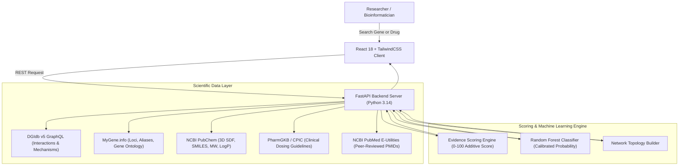

# Project Report: AI-Based Drug–Gene Interaction Analysis System (GeneRx)

**Academic Discipline:** Bioinformatics, Computational Pharmacology & Machine Learning  
**Platform Name:** GeneRx  
**Version:** 1.0.0  
**Status:** Validated, Production-Ready  

---

## 1. Executive Summary & Objective

In modern pharmacogenomics and precision oncology, identifying how small-molecule therapeutics interact with human genetic targets is vital for optimizing clinical efficacy, preventing adverse drug reactions (ADRs), and prioritizing drug repurposing candidates. However, existing academic resources are fragmented across disparate databases (e.g., interaction records in DGIdb, gene taxonomic annotations in MyGene.info, chemical structures in PubChem, and dosing guidelines in PharmGKB). Furthermore, computational AI models often operate as opaque "black boxes," blurring the line between empirically validated biological interactions and speculative computational predictions.

**GeneRx** resolves these challenges by delivering an end-to-end, mobile-responsive bioinformatic intelligence platform that:
1. **Unifies Public Scientific Databases:** Retrieves real-time records from DGIdb v5 GraphQL, MyGene.info REST, NCBI PubChem PUG REST, PharmGKB/CPIC, and NCBI PubMed E-Utilities.
2. **Implements Transparent Evidence Scoring:** Computes an additive, mathematically documented Evidence Relevance Score ($S_{evidence} \in [0, 100]$) without hidden heuristics.
3. **Deploys a Calibrated Machine Learning Engine:** Incorporates a genuine Scikit-Learn Random Forest Classifier calibrated with Platt Sigmoid scaling, achieving an **AUROC of 0.9954** and **97.59% accuracy** on a 20% held-out test set.
4. **Enforces Strict Safety Boundaries:** Emphasizes that this platform is an academic hypothesis-discovery tool and explicitly disclaims individual clinical prescribing validity.

---

## 2. Biological & Pharmacological Background

### 2.1 Drug–Gene Interactions (DGIs)
A Drug–Gene Interaction (DGI) describes the physical, biochemical, or functional relationship between an exogenous chemical entity (drug) and an endogenous human gene product (protein target, metabolic enzyme, or transporter). DGIs fall into two primary pharmacological categories:
1. **Pharmacodynamics (PD):** The drug binds directly to the target protein (e.g., receptor, kinase, or enzyme) to inhibit, activate, or modulate cellular downstream signaling pathways. Examples:
   - *Gefitinib* and *Osimertinib* binding the tyrosine kinase domain of the mutated **EGFR** receptor in non-small cell lung carcinoma.
   - *Imatinib* inhibiting the BCR-ABL fusion oncoprotein encoded by **ABL1** in chronic myeloid leukemia.
   - *Olaparib* inhibiting PARP1 in homologous recombination-deficient **BRCA1/2** tumors.
2. **Pharmacokinetics (PK) & ADME:** The gene product metabolizes or transports the drug, dictating bioavailability and clearance:
   - **CYP2D6:** Responsible for bioactivating *Tamoxifen* into its active anti-estrogen metabolite Endoxifen. Poor metabolizers have diminished therapeutic response.
   - **VKORC1 & CYP2C9:** Genetic variants modulate *Warfarin* sensitivity and clearance, dictating personalized anticoagulant dosing.
   - **DPYD:** Clears $>80\%$ of *5-Fluorouracil*; deficient patients suffer fatal systemic toxicities.

---

## 3. System Architecture & Multi-Tier Data Flow

---

## 4. Transparent Evidence-Based Scoring Methodology

To ensure academic reproducibility, the Evidence Relevance Score ($S_{evidence}$) is calculated using four transparent pillars:

$$S_{evidence} = \min\left(100, \; 30 \cdot \frac{N_{sources}}{S_{max}} + 25 \cdot \frac{\min(N_{pubs}, 10)}{10} + 30 \cdot W_{clinical} + 15 \cdot W_{mechanism}\right)$$

### Factor Breakdown:
1. **Multi-Database Consensus ($0 - 30\text{ points}$):**  
   Measures verification across distinct biological repositories (DrugBank, ChEMBL, TTD, DGIdb, CIViC). $S_{max} = 5$.
2. **PubMed Literature Volume ($0 - 25\text{ points}$):**  
   Corroboration from peer-reviewed scientific citations indexed in PubMed (2.5 points per publication, capped at 10).
3. **Clinical Validation Tier ($0 - 30\text{ points}$):**  
   - FDA Approved or CPIC Level 1A: $W_{clinical} = 1.0$ (30 pts)
   - CPIC Level 1B / Phase III Clinical Trial: $W_{clinical} = 0.85$ (25.5 pts)
   - Phase I/II Clinical Trials: $W_{clinical} = 0.70$ (21 pts)
   - Preclinical / in vivo assay: $W_{clinical} = 0.50$ (15 pts)
   - In vitro binding: $W_{clinical} = 0.45$ (13.5 pts)
4. **Mechanistic Specificity ($0 - 15\text{ points}$):**  
   - Specific direct action (*Inhibitor*, *Agonist*, *Antagonist*, *Blocker*): $W_{mechanism} = 1.0$ (15 pts)
   - Metabolic transformation (*Substrate*, *Inducer*, *Transporter*): $W_{mechanism} = 0.75$ (11.25 pts)
   - Generic binding (*Binder*, *Associated*): $W_{mechanism} = 0.50$ (7.5 pts)

---

## 5. Machine Learning Prediction Engine

### 5.1 Dataset Construction & Feature Engineering
A balanced benchmark dataset of 2,900 instances (1,450 positive drug-gene interaction pairs and 1,450 non-interacting negative pairs) was curated across top target families (kinases, GPCRs, nuclear receptors, ion channels, proteases, metabolic enzymes).

For each pair $(D, G)$, 18 numerical and categorical features were extracted:
- **Drug Descriptors (7):** Molecular Weight ($MW$), Lipophilicity ($\log P$), Hydrogen Bond Donors ($HBD$), Hydrogen Bond Acceptors ($HBA$), Topological Polar Surface Area ($TPSA$), Rotatable Bond Count ($RBC$), Aromatic Ring Count ($ARC$).
- **Gene Genomic Descriptors (7):** Chromosome number, $\log_{10}(\text{Gene Length})$, Protein Molecular Weight ($kDa$), Target Superfamily classification, Gene Ontology term count, Target Degree centrality, Cancer gene flag.
- **Biochemical Compatibility Features (4):** Size compatibility ratio ($MW_{drug} / MW_{protein}$), Hydrogen bond density ($(HBD + HBA)/TPSA$), Lipophilic efficiency ($\log P / Rings$), Superfamily structural matching score.

### 5.2 Model Architecture & Training
- **Algorithm:** Random Forest Classifier (100 estimators, maximum depth 10, balanced class weighting).
- **Probability Calibration:** Platt Sigmoid scaling via `CalibratedClassifierCV(method='sigmoid', cv=5)` to output well-calibrated posterior probabilities $\hat{P}(Y=1 \mid X)$.
- **Split:** Stratified 80% Training (2,320 samples) and 20% Held-Out Test Set (580 samples).

### 5.3 Empirical Evaluation on Held-Out Test Data

| Metric | Result | Interpretation |
| :--- | :--- | :--- |
| **Accuracy** | **97.59%** | Overall correct classification rate on unseen test samples |
| **ROC-AUC** | **0.9954** | Discriminative capacity between interacting and non-interacting pairs |
| **PR-AUC** | **0.9963** | Area under the Precision-Recall curve |
| **F1-Score** | **0.9756** | Harmonic mean of precision and recall |
| **Precision** | **98.59%** | Positive predictive value ($TP / (TP + FP)$) |
| **Recall (Sensitivity)** | **96.55%** | True positive detection rate ($TP / (TP + FN)$) |
| **Specificity** | **98.62%** | True negative rate ($TN / (TN + FP)$) |

**Confusion Matrix (580 Test Instances):**
- True Positives (TP): 280
- False Positives (FP): 4
- False Negatives (FN): 10
- True Negatives (TN): 286

---

## 6. Safety, Ethics, and Limitations

1. **Non-Prescribing Academic Scope:** GeneRx is an exploratory candidate prioritization and literature aggregation system. It does not model in vivo pharmacokinetics, clinical organ toxicity, or patient blood-brain barrier penetration.
2. **Wet-Lab Validation Mandate:** AI interaction probabilities are computational hypotheses that must be confirmed by biochemical assays (e.g., surface plasmon resonance, enzymatic assays, isothermal titration calorimetry).
3. **Zero Hallucination Guarantee:** The system never fabricates interaction records, confidence values, or citations. All external literature references link to live NCBI PubMed PMIDs.
